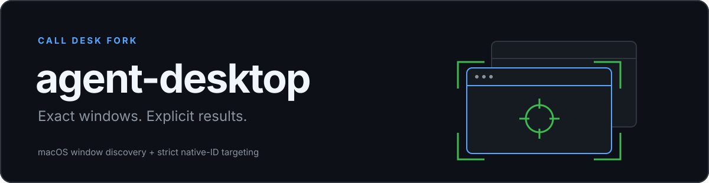
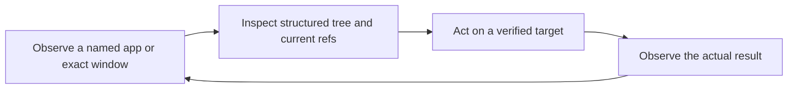

<p align="center">
  
</p>

<p align="center">
  <strong>Give an agent a window to read, a control to act on, and evidence to check.</strong><br />
  Native desktop control through the operating system's accessibility tree.
</p>

<p align="center">
  <a href="LICENSE"></a>
  
  
  
</p>

<p align="center">
  <a href="#why-this-fork-exists">The fixes</a> ·
  <a href="#install-this-fork">Install</a> ·
  <a href="#point-your-agent-here">Agent instructions</a> ·
  <a href="#the-observeactverify-loop">How it works</a> ·
  <a href="#validation-and-boundaries">Validation</a>
</p>

---

**This is Joe Wilson's Call Desk source fork of [Vercel Labs' agent-desktop](https://github.com/vercel-labs/agent-desktop).** It adds the macOS window-discovery and exact-window identity repairs used by [Shared Call Desk](https://github.com/joewilsonai/shared-call-desk). Upstream authorship, history, and the [Apache-2.0 license](LICENSE) are preserved.

Source on `main` incorporates upstream commit [`31b757a9`](https://github.com/vercel-labs/agent-desktop/commit/31b757a990a1189c9df8128df10e8df2ee5e15e1) and retains our window repairs. The installation examples remain pinned to the earlier `call-desk-macos-2026-11-02` release; updating source does not upgrade an installed tool. The exact source revision identifies each build. The upstream npm package and a matching CLI version string do not establish that these modifications are installed.

## Why this fork exists

A window title is not a window identity. Two windows can share a title, and the accessibility API can expose the real window through several different attributes.

This fork changes how the macOS adapter discovers and resolves those windows:

| Situation | Fork behavior |
| --- | --- |
| A real window is missing from `AXWindows` | Also inspect `AXMainWindow`, `AXFocusedWindow`, and window references in `AXChildren`. |
| An operation specifies a native window ID | Require one unique matching native window. |
| A same-title window exists but its native ID differs | Do not use it as a fallback for the explicitly selected window. |
| Permissions, identity, or controls cannot be verified | Retain an explicit failure or incomplete observation. |

These are focused native-window repairs. They do not make every app accessible, remove permission requirements, or solve browser focus and macOS Spaces behavior.

See [fork provenance and installation](FORK.md) for the exact base, changes, and build procedure.

## Upstream changes on main

The synchronized source adds cross-process accessibility tokens for exact element re-identification and removes the old macOS background command host. It also supports the Dock, menu bar status items, windowless apps, and system panels such as Control Center. These changes come from upstream; the fork retains its native-window discovery and exact-ID repairs.

A windowless snapshot or system-surface result can omit `data.window`. Consumers must check for it, and a process root must not substitute for an explicitly enrolled native window. The JSON envelope is 2.6. Take fresh snapshots when moving to this implementation.

**Upgrade behavior:** running the new CLI, even for a version query, stops matching legacy agent-desktop command hosts. Coordinate a cutover before executing a new build alongside agents using an older installation. Source synchronization does not establish live Call Desk compatibility; the pinned release stays available until desktop and integration checks qualify a replacement.

## What agent-desktop does

- Read native app and window accessibility trees as structured JSON.
- Give actionable elements snapshot-qualified references.
- Click controls, enter text, scroll, operate windows, and inspect supported system surfaces.
- Re-identify controls before acting and report stale or ambiguous targets.
- Keep namespaces separate for concurrent agent tasks.
- Carry version-matched usage instructions inside the binary.

The observe-act loop stays in your agent. agent-desktop does not embed a language model. It has **60 command names, 56 operational commands** on macOS. Held-input commands `key-down`, `key-up`, `mouse-down`, and `mouse-up` fail closed on that platform.

Upstream includes Windows and Linux implementations. This fork's modifications and local validation target macOS ARM64; they are not a new cross-platform qualification.

## Install this fork

### Requirements

- macOS with a graphical login session.
- Git, Rust 1.89+, and Xcode command-line tools for a source build.
- Appropriate native permissions for the operations you intend to perform.

### Build the versioned source

```sh
git clone https://github.com/joewilsonai/call-desk-agent-desktop.git
cd call-desk-agent-desktop
git checkout --detach call-desk-macos-2026-11-02

scripts/cargo-test-isolated-home.sh test --locked \
  -p agent-desktop-core -p agent-desktop-macos -p agent-desktop -p agent-desktop-ffi --lib

env -u AGENT_DESKTOP_HOME cargo build --release --locked -p agent-desktop
env -u AGENT_DESKTOP_HOME cargo build --release --locked \
  -p agent-desktop-macos --bin agent-desktop-macos-helper

./target/release/agent-desktop --version
```

Keep `agent-desktop-macos-helper` beside `agent-desktop` when installing the macOS binaries. Preserve an existing installation before changing command resolution. The [Call Desk dependency guide](https://github.com/joewilsonai/shared-call-desk/blob/main/third_party/agent-desktop/README.md) provides the versioned-directory and backup procedure.

For a published archive, use the [fork's releases](https://github.com/joewilsonai/call-desk-agent-desktop/releases) and the validation/checksum files attached to that specific release. Available assets determine the supported download targets.

### Inspect permissions

```sh
agent-desktop permissions
agent-desktop permissions --guide
```

macOS Accessibility access is required for native controls. Screenshots can require Screen Recording permission. Follow the normal macOS workflow when a grant is needed; a build, version string, or settings entry alone is not evidence of effective access.

## Point your agent here

Give Claude, Codex, or another local coding agent this repository URL and paste:

> Install the Call Desk fork of agent-desktop from https://github.com/joewilsonai/call-desk-agent-desktop. Read its README and FORK.md. Use the pinned fork release, preserve my existing native-control tools, build or install the matching CLI and macOS helper together, and verify the result. Read the binary's desktop and platform skills before operating apps. Report any missing build dependency or required native permission. Installation alone does not authorize messages, calls, or changes in other apps.

After installation, the binary provides its own operating instructions:

```sh
agent-desktop skills get desktop
agent-desktop skills get platform
agent-desktop snapshot --help
```

The [repository instructions](AGENTS.md) are for contributing to the code. The embedded skills are for agents operating the installed tool.

## The observe-act-verify loop



An example starting observation:

```sh
agent-desktop --session my-task snapshot --app Finder -i
```

If there are multiple candidate windows, select an actual native window ID returned by a fresh inventory. Inspect the snapshot, choose its current reference, then act. The following reference is illustrative; replace it with one from your own observation:

```sh
agent-desktop --session my-task click '@s8f3k2p9:e8'
agent-desktop --session my-task snapshot --app Finder -i
```

A reference belongs to its snapshot and namespace. After a UI change or `STALE_REF`, take a new observation. Do not invent a reference or treat a stale one as permission to click a nearby control.

### A receipt is not a postcondition

Read the JSON envelope and its evidence:

- `ok` reports the command's result within the documented contract.
- Delivery disposition distinguishes a dispatched action from an unperformed one.
- Snapshot coverage distinguishes a complete tree from partial data.
- A fresh observation establishes the visible postcondition.

A successful dispatch does not prove a text was delivered, a call was answered, or a settings change persisted.

## Agent sessions and concurrency

Use a distinct `--session` for each workstream. Refresh refs after state changes and preserve the exact app/window identity that produced them.

Sessions separate snapshot namespaces. They do not give agents independent copies of an app, a browser account, or the physical desktop. Shared surfaces still need coordination, especially when using foreground input.

Headless semantic actions are the default. `--headed` permits foreground activation and physical input where supported; it can interrupt the user's work. A readable offscreen window is not automatically actionable.

## Validation and boundaries

The pinned release's macOS validation includes **2,528 host library tests**, source rules, architecture boundaries, formatting, and Clippy. These historical results describe that release, not subsequent source on `main`. The release validation file states which build and smoke checks completed. The test badge represents local checks, not hosted CI or a guarantee of unattended operation.

The synchronized source passed **2,592 host library tests**, 8 FFI stub passthrough tests, 3 documentation contract tests, formatting, Clippy, and the source/architecture guards on macOS ARM64. Four synthetic locator scenarios retained correct live-path results. Native desktop E2E and latency qualification remain pending; synthetic timings under concurrent workloads do not establish native performance. The header-generation drift check was skipped because cbindgen was unavailable locally; the committed header is unchanged from the synchronized upstream revision.

The original patch also passed exact-window fixture checks before publication. Known limits remain:

| Limit | Practical effect |
| --- | --- |
| An app exposes no usable accessibility tree | The CLI cannot manufacture native controls. |
| Permissions or identity are unavailable | The operation can fail or return incomplete evidence. |
| Browser pages change during observation | Refs and visible state can become stale. |
| A window is on another Space or occluded | Foreground actions may need operator attention. |
| Several agents operate one surface | Session separation alone does not prevent conflicting actions. |

Desktop trees, screenshots, clipboard data, and logs can contain private content. Keep raw artifacts out of public reports and source control.

## C interface and upstream documentation

The upstream C interface remains available. The ABI major is 7 on `main`; the older pinned release carries its matching earlier ABI. Consumers should check the installed library against the header's `AD_ABI_VERSION_MAJOR`. See the [FFI skill](skills/agent-desktop-ffi/SKILL.md) and [generated header](crates/ffi/include/agent_desktop.h).

- [Command and JSON contract](docs/json-output.md)
- [Upstream installation and permissions reference](docs/install.md)
- [Concepts and terminology](CONCEPTS.md)
- [Contributing](CONTRIBUTING.md)
- [Fork provenance](FORK.md)
- [Shared Call Desk](https://github.com/joewilsonai/shared-call-desk)
- [Upstream Vercel Labs repository](https://github.com/vercel-labs/agent-desktop)

## License and credit

Apache License 2.0. The upstream implementation is by Vercel Labs and its contributors. This separate Call Desk distribution adds the documented macOS window repairs and keeps the original project history and license. It is not an official Vercel release or a Google-supported product.
